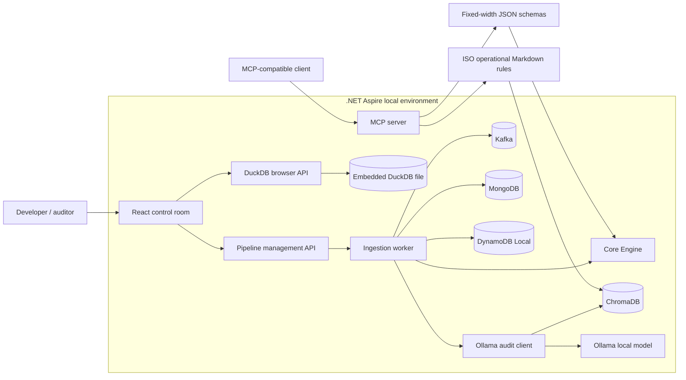
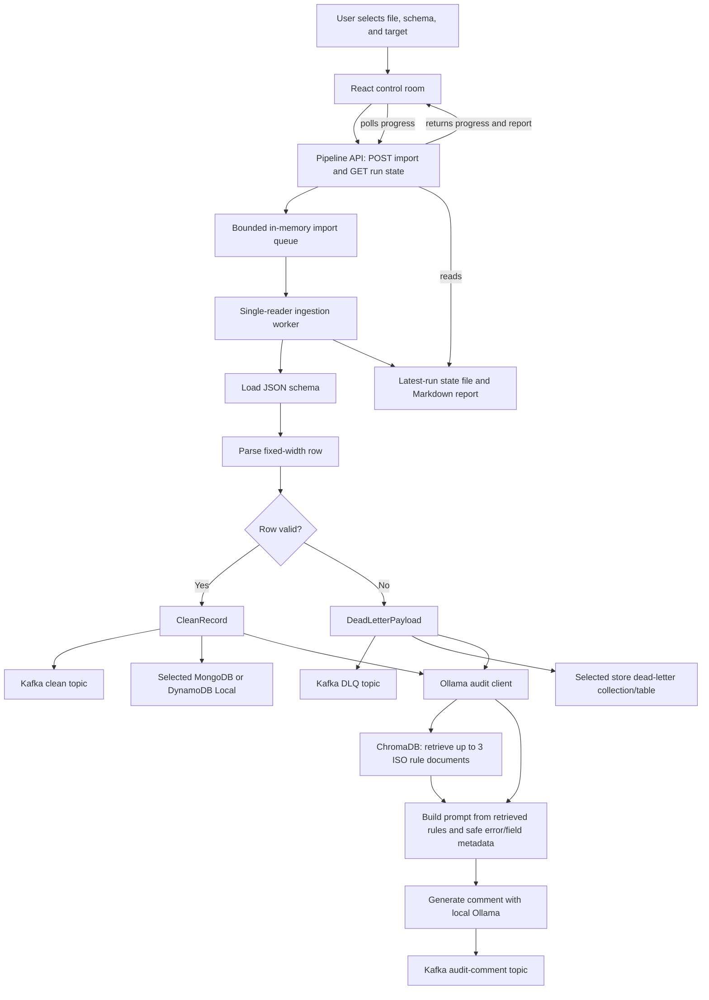
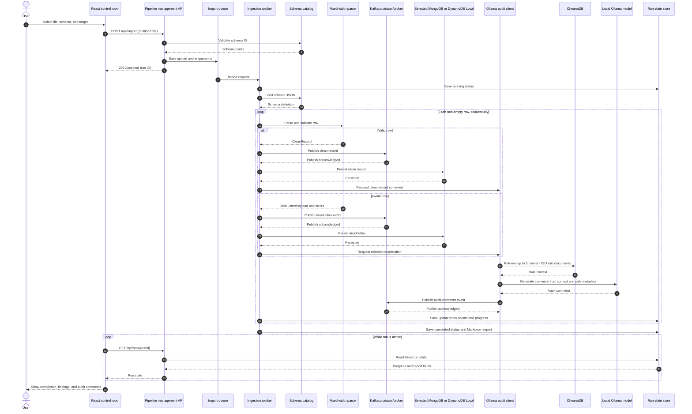
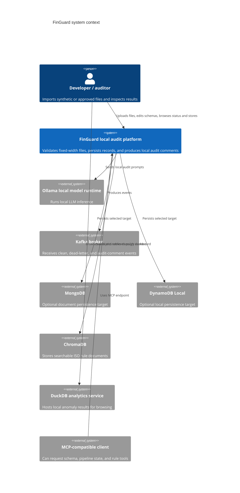
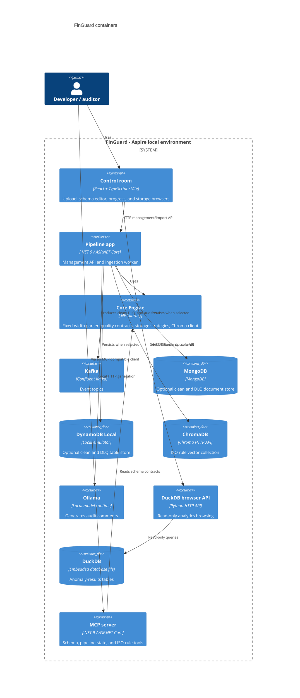
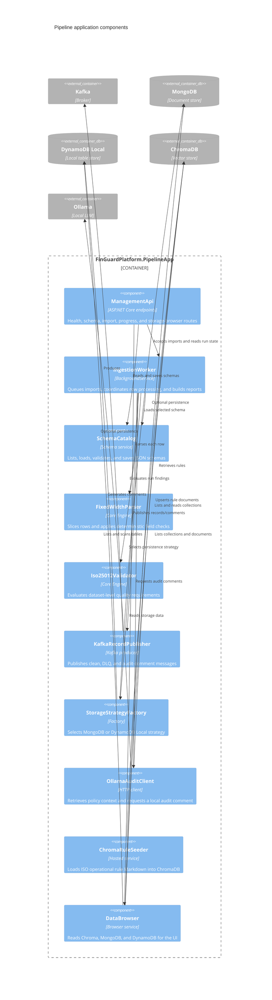
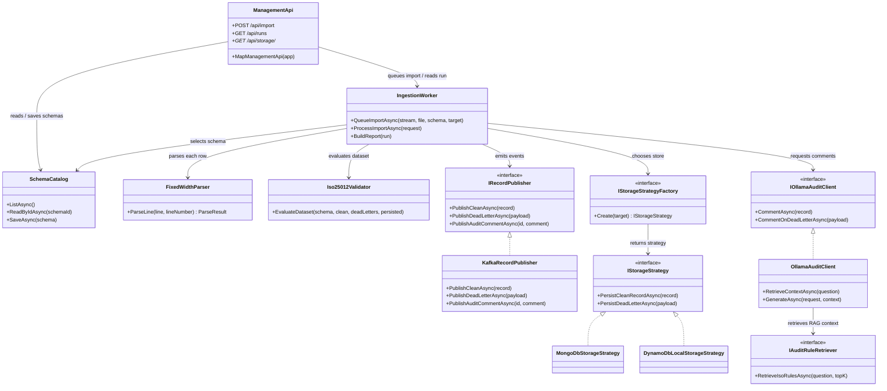

# FinGuard architecture

This page describes the implemented local Aspire solution. It includes an
overview, a file-processing data flow, and four views at increasing levels of
detail following C4: system context, containers, pipeline components, and
processing code. The C4 code-level view is a Mermaid class diagram because
Mermaid's C4 notation does not define a dedicated code-level diagram.

## Solution architecture overview

MongoDB and DynamoDB Local are alternative per-import targets. DuckDB is a
separate analytics service and is not currently fed by fixed-width imports.
Kafka currently has producers but no FinGuard consumer.

## Data flow: import, validation, audit, and persistence

The worker processes rows sequentially within a run. Parser/schema validation
determines clean versus dead-letter status; it does not rely on the LLM. The
current worker publishes each event and persists it directly, then obtains the AI
comment. Kafka is therefore an event stream alongside direct persistence, not a
consumer-driven persistence stage. Progress is persisted as a latest-run state,
not a durable full run history.

## Data flow: sequence diagram

The sequence below expands a single import into API acceptance, per-row
processing, local RAG-assisted audit, and UI progress polling. The `alt` branches
show that clean and rejected rows are both published, persisted to the selected
target, and sent through the audit-comment flow.

## C4-1: System context

## C4-2: Containers

## C4-3: Pipeline component view

## C4-4: Code-level processing view

## Boundaries and current limitations

- There is no Kafka consumer in the current solution, so published events are
  observable through Kafka tooling but are not consumed by a FinGuard downstream
  processing service.
- MongoDB and DynamoDB Local are alternatives selected per import; selecting one
  does not mirror writes to the other.
- The fixed-width import flow does not write to DuckDB. DuckDB serves a separate
  preloaded JSON analytics example.
- In-memory queue/run behavior and latest-run persistence do not constitute a
  durable queue or immutable audit history.
- Local services and project-authored rule notes are not a zero-egress guarantee,
  security certification, or regulatory compliance certification.
